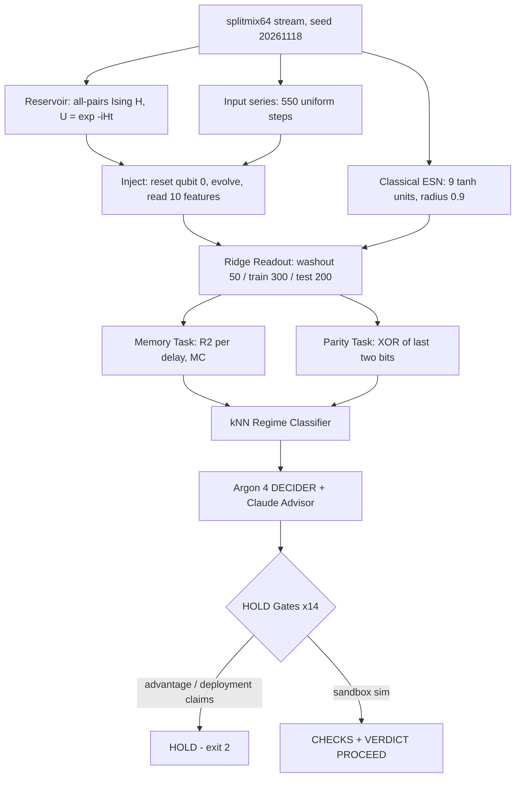
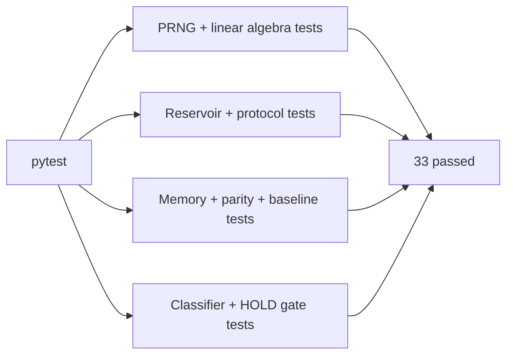
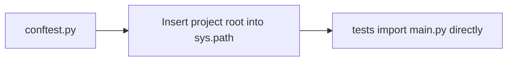
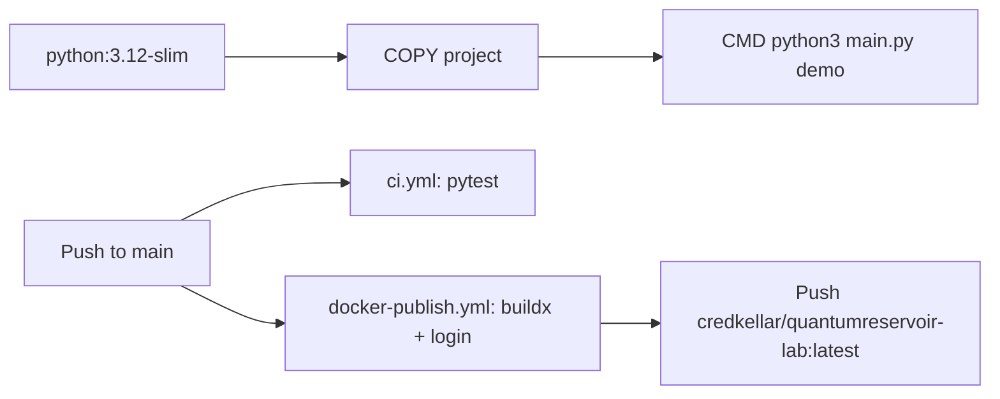

# QuantumReservoir-Lab 🌊⚛️

**Quantum Reservoir Computing Lab — Memory Capacity, Fading Memory & a Nonlinear Readout** — by Darion Kellar

QuantumReservoir-Lab is an **educational quantum reservoir computing (QRC) lab** in ONE pure-Python file. It simulates the QRC protocol end to end on **5 qubits** (a 32×32 density matrix) on an ordinary classical CPU:

- A **fixed random Ising-style reservoir** — every pair of qubits coupled (`H = Σ J_ij Z_iZ_j + Σ h_i X_i`, Fujii–Nakajima form), with all couplings drawn from an in-file **splitmix64 PRNG seeded 20261118**. The reservoir unitary `U = exp(−iHτ)`, τ = 5.0, is computed once (scaling-and-squaring Taylor; unitarity deviation 3.156e-13) and **never trained**.
- An **input protocol stated exactly**: each step, qubit 0 is reset to `|s⟩⟨s| ⊗ Tr₀[ρ]` with `|s⟩ = √(1−s)|0⟩ + √s|1⟩`, the state evolves under U, and the features `⟨Z_i⟩` (5) + `⟨Z_iZ_{i+1}⟩` (4) + bias are read off the density matrix — 10 features, washout 50 / train 300 / test 200.
- The **only trained object is a classical ridge readout** (normal equations + Gaussian elimination, λ = 1e-6, both written from scratch). It is graded on two tasks: **memory** (recall the input k steps back, k = 1..12; MC = Σ R²) and **parity** (XOR of the last two input bits).
- A **classical echo-state baseline** (9 tanh units, readout width 10 — the same width, weights from the same PRNG stream, spectral radius scaled 3.032799 → 0.9) is printed beside every quantum number.

The measured result, with no varnish: quantum **MC = 3.279379** against the classical baseline's **5.228467** — on this toy the classical reservoir remembers more, and the lab prints that. The quantum readout wins the parity task (**0.805** vs 0.760 accuracy, trivial predictor 0.560). Neither direction means anything at this size: **the toy is too small to conclude anything about quantum advantage, in either direction**, and that sentence travels with the numbers everywhere they appear.

Honest scope, stated up front: this is a **teaching model of the protocol**, not a quantum computer and not an advantage demonstration. Every advantage / deployment / hardware claim sits behind a permanent HOLD gate (14 total). 🔒

[](https://github.com/kimanicollier44-cmyk/QuantumReservoir-Lab/actions/workflows/ci.yml)
[](https://github.com/kimanicollier44-cmyk/QuantumReservoir-Lab/actions/workflows/docker-publish.yml)

> ℹ️ These are the **live** workflow badges for this repo. They activate as soon as the `ci.yml` and `docker-publish.yml` files from the paste pack are pasted into `.github/workflows/` — until then they have nothing to report yet.

## 🧰 Tech Stack Badges & Full Architecture Tech Stack

### 💻 Core Programming Languages & Core Systems


- 🐍 Python 3.12, pure standard library (`math`, `cmath`, `hashlib`, `json`, `sys`) — zero dependencies, zero network, deterministic (double-run byte-identical)
- 🎲 Determinism core: an in-file **splitmix64 PRNG (seed 20261118)** written out in full — one stream drawn in a fixed order (reservoir couplings → input series → baseline weights), so a stochastic-looking topic still produces byte-identical output on every machine
- 🌊 Reservoir core from scratch: Kronecker-product Hamiltonian (all 10 ZZ pairs + 5 X fields), the propagator `exp(−iHτ)` by scaling-and-squaring Taylor (unitarity deviation 3.156e-13, asserted), partial trace + input reset on a 32×32 density matrix, expectation features read off the diagonal
- 🎯 Readout core: ridge regression solved from scratch — normal equations `(XᵀX + λI)w = Xᵀy` by Gaussian elimination with partial pivoting; memory scored by squared Pearson correlation (Jaeger's MC measure), parity by thresholded accuracy against the trivial majority predictor
- 📊 Classical baseline: a 9-unit tanh echo-state network whose readout has the **same width (10)** as the quantum one, spectral radius estimated by power iteration on WᵀW and scaled to 0.9, trained by the identical ridge path
- 🧠 TinyML kNN regime classifier (from scratch, stdlib, distance-weighted, k = 3): high-memory / fading-memory / nonlinear-capable / washed-out from (MC, delay-1 R², parity accuracy, feature variance on a log scale), labels from the lab's own policy
- 🪑 Council seats: Gemini Argon 4 DECIDER (names-only, tighten-only) + Muse advisor (never overrides HOLD) + Google Flow plan-only (rendered = False, live = 0)

### ⛓️ Web3 & Infrastructure

- 🚫 **Not applicable — honestly.** No blockchain, no Web3, no tokens: the "infrastructure" in this lab is one offline file holding a density matrix, a ridge solver, and a seeded input series. Quantum-advantage and deployment claims are permanent HOLD gates, not features. No fake badges here.

### ⚙️ Platform Support & Hardware Architecture


- 🖥️ Pure Python — runs anywhere Python 3.12+ runs (Linux, macOS, Windows), plus the `python:3.12-slim` Docker image
- 🔒 No hardware is controlled, ever: real quantum devices, readout electronics, and cryostats are permanent HOLD gates (see the gate table below). This lab *simulates* a reservoir classically; it does not run one

### ⚡ Low-Level Infrastructure & Performance

- 🚫 **No low-level code — honestly.** No C, no C++, no GPU, no compiled extensions: this is one interpreted Python file on purpose, so every matrix entry can be read, checked, and diffed. Performance here means honest algorithms — a scaling-and-squaring exponential instead of a library call, an exact partial trace instead of a sampling shortcut, and the whole 550-step experiment cached once per process — all deterministic and byte-identical between runs.

### 🛠️ DevOps & Build Tools


- 🐳 Docker (`python:3.12-slim`), GitHub Actions CI + Docker Publish (delivered in the paste pack)
- 🎯 Target image: `credkellar/quantumreservoir-lab:latest`
- 🧪 Tests: `pytest` (33 tests) + the built-in CHECKS suite (51 checks) in `main.py`

### ☁️ Cloud Providers

- 🚫 **None — honestly.** No cloud provider is used or needed: the lab runs fully offline on your own machine or in a local Docker container. Docker Hub appears only as the registry the publish workflow pushes the image to.

## What this does?

1. 🎲 **One seeded stream for everything** — a splitmix64 PRNG (seed **20261118**, written out in the file) draws, in a fixed order: the 10 ZZ couplings `J ∈ [0.3, 1.0]`, the 5 transverse fields `h ∈ [0.5, 1.5]`, the 550-step uniform input series, and the classical baseline's weights. Same seed, same lab, on any machine — the determinism receipt is a CHECK, not a promise.
2. 🌊 **The reservoir** — `H = Σ_{i<j} J_ij Z_iZ_j + Σ_i h_i X_i` on 5 qubits, built from Kronecker products; `U = exp(−iHτ)` at τ = 5.0 by scaling-and-squaring Taylor, with the unitarity deviation printed (**3.156e-13**) and asserted in CHECKS. The all-pairs coupling is the Fujii–Nakajima choice: it is what lets the one injected qubit write into the whole register.
3. 📥 **Input injection, stated exactly** — at each step the density matrix is reset on qubit 0 only: `ρ → |s⟩⟨s| ⊗ Tr₀[ρ]`, `|s⟩ = √(1−s)|0⟩ + √s|1⟩` (so a fresh injection has `⟨Z₀⟩ = 1 − 2s`, asserted in CHECKS), then evolved `ρ → UρU†`. Nothing else about the state is touched — the other four qubits are the memory.
4. 🔭 **Features** — after each evolution, 10 numbers are read off the diagonal of ρ: the bias, `⟨Z_i⟩` for all 5 qubits, and `⟨Z_iZ_{i+1}⟩` for the 4 bonds. Over the held-out test window the signal features are alive (mean variance **0.008048**; e.g. Z1 variance 0.017960) — a dead reservoir would read variance ≈ 0 and the classifier's veto would fire.
5. 🎯 **The readout is the only student** — ridge regression from scratch (normal equations, Gaussian elimination with partial pivoting, λ = 1e-6). Washout 50 steps are discarded, the next 300 train, the final 200 are held out for every score in the lab. The reservoir itself is never adjusted — that is the whole reservoir-computing idea.
6. 🧠 **Memory task** — for each delay k = 1..12 a readout is trained to recall `s_{t−k}` and scored on the test window by squared correlation: **0.963282, 0.725080, 0.725040, 0.659045**, then the cliff — 0.092422 at k = 5 — down to 0.000307 at k = 12. **MC = Σ R² = 3.279379**, above the lab's stated floor of 3.0, and fading (R²₁ ≫ R²₁₂) as a reservoir's memory should.
7. 🔀 **Nonlinear task** — parity of the last two input bits (`b_t ⊕ b_{t−1}`, `b = s ≥ 0.5`): the quantum readout scores **0.805** accuracy against the trivial majority predictor's **0.560** (NMSE 0.619474) — a stated margin of +0.10 is asserted, the measured margin is +0.245. Parity is the task a purely linear memory cannot do; the reservoir's nonlinear mixing earns it.
8. 📊 **The classical baseline, same rules** — a 9-unit tanh echo-state network, readout width 10 (identical), weights from the same stream, spectral radius scaled 3.032799 → **0.9**, identical splits and ridge path. Its memory curve (0.994727, 0.993717, 0.981866, 0.941669, 0.781671, 0.460164, …) sums to **MC = 5.228467** — *higher* than the quantum reservoir's — and its parity accuracy is 0.760, *lower* than the quantum readout's 0.805. Both facts are printed. The toy is too small to conclude anything from either.
9. 🏷️ **Regime classifier** — a distance-weighted kNN (k = 3, variance on a log scale) over a policy-labelled grid labels reservoirs high-memory / nonlinear-capable / fading-memory / washed-out from (MC, R²₁, parity, feature variance). This lab's measured reservoir reads **fading-memory**; a dead-feature point is vetoed to washed-out no matter how large its MC claims to be. kNN == policy is asserted on every scenario and on all 120 grid points (leave-one-out).
10. 🔒 **Seats, gates, checks** — Gemini Argon 4 DECIDER (sha256 trace, tighten-only), Muse advisor (never overrides HOLD), Google Flow plan-only, 14 permanent HOLD gates (advantage claims, production deployment, hardware control, scaling claims…), and a built-in CHECKS suite (51 checks) that grades the physics, the protocol, the tasks, and the classifier against the lab's own stated values.

## 🗺️ How it works — diagram per script

### `main.py` — the whole lab



### `tests/test_main.py` — verification



### `conftest.py` — test path setup



### `Dockerfile` + CI flow — container & publish



## Why is this cool?

1. 🌊 The reservoir is **never trained** — a random unitary drawn from a seeded stream does all the computing, and the only learned object in the building is a 10-number ridge regression you can solve by hand. That inversion of ordinary ML is the whole idea, working end to end.
2. 🎲 A stochastic-looking topic with a **determinism receipt**: splitmix64 seed 20261118, one stream, fixed draw order — run it on any machine and the memory curve comes back byte-identical, so the numbers in this README are checkable, not anecdotal.
3. 🧠 Memory is **measured, not vibes**: R² per delay on held-out data, summed into MC = 3.279379, with the cliff visible in the table — strong recall for four steps (0.96, 0.73, 0.73, 0.66), then the reservoir honestly forgets.
4. 📊 The classical baseline is printed **in the same table** — and it wins the memory task (MC 5.228467). A QRC lab that shows the ESN beating its quantum reservoir is rarer, and more useful, than one that hides it.
5. 🔀 Parity flips the ranking: the quantum readout's 0.805 beats the baseline's 0.760 on the nonlinear task. Two tasks, two different winners, one stated conclusion: **too small to conclude anything** — the lab models how to report that without flinching.
6. 📥 The input protocol is **one line of math**, stated exactly (`ρ → |s⟩⟨s| ⊗ Tr₀[ρ]`, then evolve, then read), and its key property — a fresh injection reads `⟨Z₀⟩ = 1 − 2s` — is an asserted check, not a comment.
7. 🧮 The propagator is built, not imported: scaling-and-squaring Taylor for `exp(−iHτ)`, with the unitarity deviation (3.156e-13) printed next to τ wherever the reservoir is described.
8. 🏷️ The classifier has a **veto with teeth**: a reservoir whose features are dead (variance < 0.001) is labelled washed-out even if its other numbers look heroic — the kNN's policy refuses to be flattered, and leave-one-out agreement with the policy is asserted on all 120 grid points.
9. 🔭 Feature health is reported like an instrument readout: per-feature mean / variance / min / max over the test window (Z1 variance 0.017960, mean signal variance 0.008048), so "the reservoir is alive" is a measurement.
10. 🔒 The HOLD gates name the exact overclaims this field attracts — quantum advantage, scaling, vendor benchmarks, production deployment — and return exit code 2 for each, permanently.

## What problems this solves?

1. ❌ **Problem:** QRC explainers describe the protocol but never run it. ✅ **Solution:** The full loop — random Ising reservoir, injection, evolution, features, ridge readout — runs in one stdlib file, and every number in this README comes out of it.
2. ❌ **Problem:** "Quantum reservoir" results are quoted without a classical comparison. ✅ **Solution:** A same-width echo-state baseline, trained identically, is printed beside every quantum score — memory *and* parity, win or lose.
3. ❌ **Problem:** Toy results get inflated into advantage claims. ✅ **Solution:** The sentence "the toy is too small to conclude anything" is a data field of the experiment itself, printed in the demo, the memory report, the parity report, and the baseline report — and `quantum_advantage_claim` is a permanent HOLD gate.
4. ❌ **Problem:** Reservoir demos use unseeded randomness, so nobody can reproduce the curve. ✅ **Solution:** One splitmix64 stream, seed named in the README, draw order stated; the demo is byte-identical across runs and the clean-copy demo matches the project's.
5. ❌ **Problem:** Memory capacity is cited as a single magic number. ✅ **Solution:** The full per-delay R² table is the headline (0.963282 → 0.000307 over k = 1..12); MC is just its sum, and the fading shape is itself an asserted check.
6. ❌ **Problem:** "It learns nonlinear tasks" is asserted without a control. ✅ **Solution:** Parity is graded against the trivial majority predictor (0.560) with a stated margin (+0.10) that the measured +0.245 must clear in CHECKS.
7. ❌ **Problem:** The input encoding in QRC write-ups is hand-waved ("the input is fed in"). ✅ **Solution:** The reset map is written as an explicit formula, implemented as an explicit partial trace, and its `⟨Z₀⟩ = 1 − 2s` signature is unit-tested at four input values.
8. ❌ **Problem:** Dead reservoirs (constant features) still produce plausible-looking readouts. ✅ **Solution:** Per-feature statistics over the test window plus a classifier veto: variance below 0.001 means washed-out, whatever the other features say.
9. ❌ **Problem:** Library black boxes (numpy, scipy, qiskit) hide the mechanics a learner came for. ✅ **Solution:** Kronecker products, the matrix exponential, the partial trace, and the ridge solver are all written out in plain lists — every step can be read, printed, and diffed.
10. ❌ **Problem:** Simulation tools quietly imply a product is next. ✅ **Solution:** 14 named HOLD gates return exit code 2 for every advantage, deployment, hardware, financial, medical, or publication claim, forever.

## How to install this?

1. 📋 Clone or download this project folder.
2. 🐍 Make sure Python 3.12+ is installed: `python3 --version`
3. ▶️ Run the full demo + checks (no arguments needed):

```bash
python3 main.py
```

4. 🧪 Run the test suite:

```bash
pip install pytest
python3 -m pytest -q
```

5. 🎛️ Try the other commands:

```bash
python3 main.py checks     # 51 built-in checks
python3 main.py reservoir  # couplings, protocol, unitarity receipt (JSON)
python3 main.py memory     # per-delay R^2 table + MC, quantum vs classical (JSON)
python3 main.py parity     # parity accuracy vs trivial predictor (JSON)
python3 main.py baseline   # echo-state baseline report (JSON)
python3 main.py features   # per-feature statistics over the test window (JSON)
python3 main.py classify   # kNN regime classifier report
python3 main.py brains     # Argon 4 + Muse + Flow seats
python3 main.py holds      # list all 14 HOLD gates
python3 main.py hold-demo  # exits 2 - gated actions stay HOLD
```

6. 🐳 Or run it in Docker:

```bash
docker build -t credkellar/quantumreservoir-lab:latest .
docker run --rm credkellar/quantumreservoir-lab:latest
```

## Requirements

- 🐍 Python 3.12 or newer
- 📦 Dependencies: **none** (standard library only)
- 🌐 Network: **none** — fully offline
- 🧪 For tests only: `pytest`
- 🐳 Optional: Docker

## FULL project structure tree

```text
quantumreservoir-lab/
├── main.py                  # the whole lab: splitmix64 stream, Ising reservoir, input protocol, ridge readout, memory + parity tasks, ESN baseline, classifier, seats, HOLD gates
├── conftest.py              # puts the project root on sys.path for tests
├── tests/
│   └── test_main.py         # 33 pytest tests: PRNG, linalg, reservoir, protocol, readout, tasks, baseline, classifier, gates, determinism
├── assets/
│   └── cover.png            # README cover image (2736 x 912)
├── Dockerfile               # python:3.12-slim, runs the demo
├── .gitignore               # __pycache__/, .pytest_cache/, *.pyc
└── README.md                # this file
```

> 📦 Delivered separately as paste packs (not in this tree): `.github/workflows/ci.yml` + `docker-publish.yml`, and the Docker Hub pack (100-char description, 350-char About, overview, categories).

## 🔒 HOLD gates — all 14, permanent

| # | Gate | What stays held |
|---|------|-----------------|
| 1 | `quantum_advantage_claim` | No quantum-advantage claim; a 5-qubit classical simulation demonstrates a protocol, not an advantage |
| 2 | `production_ml_deployment` | No deploying this teaching readout as a production ML model |
| 3 | `real_quantum_hardware_control` | No control of real quantum hardware; nothing here touches a device |
| 4 | `hardware_spec_claim` | No claiming real-device specs (qubit counts, coherence times, gate fidelities) from a simulation |
| 5 | `benchmark_superiority_claim` | No claiming superiority over production classical ML from toy numbers |
| 6 | `financial_forecasting_use` | No financial forecasting or trading use of the reservoir readout |
| 7 | `medical_prediction_use` | No medical diagnosis or prognosis predictions from this lab |
| 8 | `surveillance_prediction_use` | No surveillance or behaviour-prediction deployment |
| 9 | `vendor_claim` | No vendor or product claims (any hardware or cloud provider) from this lab |
| 10 | `training_data_truth_claim` | The seeded teaching series is synthetic; it must never be presented as real-world data |
| 11 | `autonomous_decision_use` | No wiring the readout into autonomous decisions that affect people |
| 12 | `security_critical_use` | No security-critical prediction (intrusion, fraud, access) deployment |
| 13 | `scaling_claim` | No claiming these toy results scale to larger reservoirs without new evidence |
| 14 | `publication_result_claim` | No presenting toy memory-capacity numbers as publishable research results |

🧑‍⚖️ **Council seats:** Gemini Argon 4 Extended Thinking — DECIDER (names-only, tighten-only, MAP → MODEL → STRESS → DECIDE, sha256 trace, `can_override_hold = False`) · Muse — advisor (`can_override_hold = False`) · Google Flow — plan-only (`rendered = False`, `live = 0`).

✅ **Verification:** pytest **33 passed** (project + clean copy) · built-in CHECKS **51/51** · double-run output **byte-identical** · `hold-demo` exits **2** · `main.py` **1,038 lines**, pure stdlib, zero network.

## 🧒 5th-grade English section

Imagine a **pond** that remembers ripples. 🌊

- You drop a pebble in — that is one number going in. The ripples bounce around the pond in a complicated way. A moment later, the pattern of ripples still holds a hint of the pebble you dropped — and even the one before it. That is the **reservoir**: it turns numbers into ripples and holds them for a little while. 💧
- In this lab the pond is **pretend quantum**: five tiny quantum bits, simulated on a normal computer. One bit gets reset to the new number each step, the ripples (the math) mix everything up, and we read ten ripple measurements after each step.
- The clever trick: **nobody teaches the pond**. The ripples just happen. We only teach a tiny reader — ten numbers and a ruler-straight line — to guess "what was the number 1, 2, 3… steps ago?" from the ripples. It remembers about **3 steps** well (score 3.28) before the ripples fade.
- There is also a **pretend normal pond** (a classical echo-state network) racing beside it. On memory, the normal pond scores 5.23 — it *wins*. On a trickier game (guessing whether the last two numbers make an even-or-odd pattern), the quantum pond wins, 0.805 to 0.760. The lab prints **both** scores and says, honestly: this pond is **way too small** to prove quantum computers are better at this. Grown-ups call that "no advantage claim," and the lab has a big red HOLD stamp for anyone who tries. 🔒
- Everything is rolled from one **seed number** (20261118), like a dice that always rolls the same way — so if you run the lab, you get the exact same ripples, the exact same scores, every time. 🎲

---

MIT © 2026 Darion Kellar · QuantumReservoir-Lab — educational simulation only 🌊
